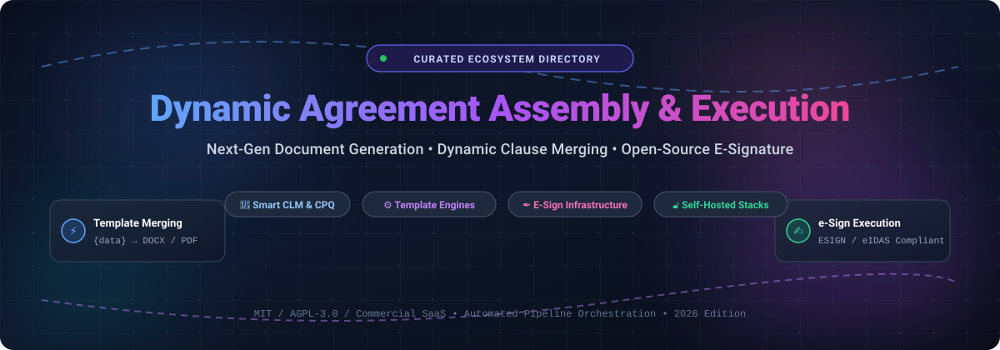

# ⚡ Awesome-Dynamic-Agreement-Assembly-Execution 📑

<p align="center">
  
</p>

<p align="center">
  <a href="https://github.com/ishandutta2007/Awesome-Awesome-Awesome"></a><a href="https://discord.gg/jc4xtF58Ve"></a>
  <a href="https://github.com/ishandutta2007/Awesome-Dynamic-Agreement-Assembly-Execution/stargazers"></a>
  <a href="https://github.com/ishandutta2007/Awesome-Dynamic-Agreement-Assembly-Execution/network/members"></a>
  <a href="https://github.com/ishandutta2007/Awesome-Dynamic-Agreement-Assembly-Execution/issues"></a>
  <a href="https://github.com/ishandutta2007/Awesome-Dynamic-Agreement-Assembly-Execution/blob/main/LICENSE"></a>
  <a href="https://github.com/ishandutta2007"></a>
</p>

---

## 🌟 Top Dynamic Agreement Assembly & Execution Ecosystem

**Curated List of SaaS Platforms & Open-Source GitHub Projects**  
*Focused on Template-Driven Document Generation, Dynamic Clause Assembly, CPQ Proposal Engine & E-Signature Execution*  
**Last updated: March 2026**

Welcome to the definitive awesome list tracking enterprise **SaaS platforms** and developer-first **open-source libraries** for **Dynamic Agreement Assembly & Execution**. These tools empower modern organizations, legal ops teams, sales engineers, and software architects to assemble legally binding contracts, proposals, and complex multi-clause documents populated with live application data—spanning Salesforce-native document generation, CPQ-driven proposal assembly, self-hosted headless template engines, and e-signature execution pipelines.

### 🔍 Key Capabilities Evaluated
- 📑 **Template-Driven Merging**: Populate Word (`.docx`), PDF, OpenDocument (`.odt`), and HTML with structured JSON/database payloads.
- 🧩 **Dynamic Clause Logic**: Conditional paragraph insertion, repetitive table rendering (`loops`), rules-based fallbacks, and multi-document packet stitching.
- ✍️ **E-Signature Execution**: Legally compliant e-signing (ESIGN, UETA, eIDAS) with tamper-evident audit trails, digital certs, and automated routing.
- 🔓 **Data Sovereignty & Self-Hosting**: Bypassing expensive per-envelope or per-user seat fees through MIT/AGPL open-source infrastructure.

---

## 📑 Table of Contents
- [📊 Sector Overview & Market Dynamics](#-sector-overview--market-dynamics)
- [☁️ SaaS/Hosted Platforms](#️-saashosted-platforms)
- [💻 Open-Source GitHub Projects](#-open-source-github-projects)
- [🛠️ Architectural Guidance & Recommendation Matrix](#️-architectural-guidance--recommendation-matrix)
- [🤝 How to Contribute](#-how-to-contribute)
- [💖 Support & Sponsorship](#-support--sponsorship)
- [📈 Star History](#-star-history)
- [⚖️ Disclaimer & Compliance](#️-disclaimer--compliance)

---

## 📊 Sector Overview & Market Dynamics

The global market for contract lifecycle management (CLM), document automation, and e-signatures represents an estimated **$15B–$22B+** ecosystem, expanding at ~13–25% CAGR as enterprise agreements shift from static templates to intelligent, dynamic workflows. The sector is **moderately fragmented yet top-heavy**: mega-cap digital document and signature infrastructure providers (e.g., Adobe, DocuSign) dominate core e-signature execution and broad horizontal workflows, while an active, fragmented ecosystem of enterprise CLM leaders and vertical document generation vendors captures specialized CPQ, CRM-native, and complex multi-clause assembly needs.

---

## ☁️ SaaS/Hosted Platforms

| Product | Company Size (Valuation / Revenue) | Pricing (Starting) | Free Tier / Trial Limits | Description |
|:---|:---|:---|:---|:---|
| **[Adobe Acrobat Sign](https://www.adobe.com/sign.html)** | **~$26.0B** TTM Revenue / ~$200B+ Market Cap | **$16.99/user/month** (annual, Acrobat Standard for teams) | **30-day free trial** (up to 200 transaction units; 7-day trial on standard Pro bundles; permanent free Developer Sandbox) | 🌐 E-signature execution layer that integrates with document generation workflows. Per-license billing with seat subscriptions. |
| **[DocuSign Gen](https://www.docusign.com/)** | **~$3.36B** TTM Revenue / ~$10B–$12B Market Cap | **$20/user/month** (annual add-on for Salesforce; base eSign starts at $10/mo) | **30-day free trial** (Business Pro evaluation; permanent free account allows signing & up to 3–5 total sent envelopes) | ⚡ Salesforce-native document generation and e-signature. Integrated into DocuSign CLM and Salesforce workflows. |
| **[Icertis Dynamic Agreement Engine](https://www.icertis.com/)** | **$5.0B** Valuation / ~$300M–$350M ARR | **~$150–$350/user/month** (enterprise contracts; median ACV starting ~$100,000/yr) | **No free self-serve trial** (guided enterprise demo & custom sandbox POC only) | 🏢 Enterprise CLM with dynamic agreement assembly using clause libraries, rules-based fallback language, and AI-assisted drafting. |
| **[Nintex Drawloop DocGen](https://www.nintex.com/)** | **~$2.0B** Valuation / ~$250M ARR | **$5,000/company/year** (or ~$12–$20/user/month equivalent) | **30-day free trial** (includes 5 full user licenses via Salesforce AppExchange + sandbox testing) | 🔄 Salesforce document generation with workflow automation. Built for high-volume enterprise generation. |
| **[HotDocs](https://www.hotdocs.com/)** | **~$1.6B** Parent Valuation (Mitratech) / ~$150M–$220M Revenue | **$25/user/month** (or ~$125/month for small team base package) | **30-day evaluation trial** (requires sales-assisted license token; or guided live demo) | 📜 Document automation and assembly platform with enterprise rules engines for legal and commercial document suites. |
| **[PandaDoc](https://www.pandadoc.com/)** | **$1.0B** Valuation / ~$100M ARR | **$19/user/month** (billed annually; $35/mo month-to-month) | **14-day free trial** (full access) + **Free forever eSign plan** (up to 5 document uploads & signatures/month) | 📝 Document workflow platform with template-based generation, quoting, and e-signature execution. |
| **[Conga Composer](https://www.conga.com/)** | **~$715M+** Acquisition Basis / ~$200M–$388M ARR | **$35/user/month** (annual baseline contract; discounts up to 25% for high-volume commitments) | **30-day free trial** (includes 10 user licenses with AppExchange install) | 📊 Salesforce-native document generation with templates, data merging, and multi-format output. |
| **[Formstack Documents](https://www.formstack.com/)** | **$425M** Valuation / ~$35M–$55M ARR | **$99/month** (Starter tier; Suite starts at $250–$299/month) | **14-day free trial** (full feature access without credit card) | 📋 Document generation platform with web forms, automated templates, and data merging integrations. |
| **[S-Docs](https://www.sdocs.com/)** | Bootstrapped / **~$6.6M** ARR | **$25/user/month** (billed annually; minimum contract requirement of $3,000/year) | **Free forever plan** (unlimited users & templates; capped at 150 document generations & 50 e-signatures total) | 🛡️ 100% Salesforce-native document generation with unlimited e-signature envelopes on signature packages. |
| **[Windward Studios](https://www.windwardstudios.com/)** | Acquired (Apryse) / **~$4.6M** Pre-Acquisition Revenue | **$209/month** (Flex model starting tier; Pro pay-per-server at $496/month) | **14-to-30-day free trial** (evaluation watermark and output cap; no credit card required) | 📈 Document generation and reporting platform with data-driven templates for complex layouts and charts. |

---

## 💻 Open-Source GitHub Projects

Sorted by GitHub star count (descending) 🌟. All star badges link directly to the repository's stargazers page.

| Project | Star Badge | Description | Category |
|:---|:---|:---|:---|
| **[DocuSeal](https://github.com/docusealco/docuseal)** | [](https://github.com/docusealco/docuseal/stargazers) | ✍️ **Open-source DocuSign alternative platform.** Ruby/Vue. Provides an intuitive web UI, mobile-optimized signing, automated form builder, PDF field mapping, webhooks, and REST API. Best for teams embedding document signing and legal agreement completion directly into web applications. | E-Signature Platform |
| **[Documenso](https://github.com/documenso/documenso)** | [](https://github.com/documenso/documenso/stargazers) | 🖋️ **The open-source digital signing infrastructure.** Next.js, TypeScript, Prisma. Comprehensive document signing platform with team management, crypto-verifiable audit logs, public signing links, and developer-first REST/GraphQL APIs. | E-Signature Platform |
| **[WeasyPrint](https://github.com/Kozea/WeasyPrint)** | [](https://github.com/Kozea/WeasyPrint/stargazers) | 🖨️ **Visual HTML/CSS to PDF document converter.** Python. Turns standard HTML and modern CSS into print-ready, multi-page PDFs with accurate page breaks, margins, headers, and footers. Ideal for dynamic document rendering using web standards. | PDF Engine |
| **[pdf-lib](https://github.com/Hopding/pdf-lib)** | [](https://github.com/Hopding/pdf-lib/stargazers) | ⚡ **Pure JavaScript PDF generation, modification, and form filling.** Works across Node.js and browsers. 12x faster than headless browser engines. Can create real AcroForm signature fields, flatten forms, draw vectors, and assemble multi-document packets. | PDF Library |
| **[OpenSign](https://github.com/OpenSignLabs/OpenSign)** | [](https://github.com/OpenSignLabs/OpenSign/stargazers) | 📜 **Enterprise-ready open-source electronic signature solution.** Node.js/React/MongoDB. Supports sequential signing workflows, OTP signer authentication, template management, drawn/typed/uploaded signatures, and secure audit trails. | E-Signature Platform |
| **[pdfme](https://github.com/pdfme/pdfme)** | [](https://github.com/pdfme/pdfme/stargazers) | 🎨 **TypeScript-based visual PDF generator and UI designer.** Embeddable canvas designer for building dynamic templates in React/JS and programmatic PDF generation engine from JSON schema. Perfect for invoice, badge, and dynamic agreement generation. | Visual PDF Generator |
| **[docxtemplater](https://github.com/open-xml-templating/docxtemplater)** | [](https://github.com/open-xml-templating/docxtemplater/stargazers) | 📄 **Word (`.docx`) and PowerPoint (`.pptx`) template engine.** JavaScript/Node.js. Replaces placeholders, loops through rows in tables, conditionally includes clauses, and inserts images directly into native Microsoft Office files using `{tags}`. | Office Template Engine |
| **[python-docx-template (docxtpl)](https://github.com/elapouya/python-docx-template)** | [](https://github.com/elapouya/python-docx-template/stargazers) | 🐍 **Jinja2 templating engine for Word documents.** Python. Design complex agreement templates directly inside Microsoft Word and render dynamic content via Jinja2 tags, filters, conditional clauses, loops, and inline sub-documents. | Office Template Engine |
| **[Carbone](https://github.com/carboneio/carbone)** | [](https://github.com/carboneio/carbone/stargazers) | 🚀 **Fast multi-format document generator from JSON data.** Node.js, MIT. Uses LibreOffice/Office documents (DOCX, ODT, XLSX, PPTX, HTML) as templates with `{d.variable}` markers. Automatically converts rendered templates to PDF with internal worker retry pools. | Universal Template Engine |
| **[LibreSign](https://github.com/LibreSign/libresign)** | [](https://github.com/LibreSign/libresign/stargazers) | 🔒 **Open-source e-signature platform integrated with Nextcloud.** AGPL-3.0. Digital Public Good certified. Features cryptographic signatures, multi-signer workflows, and data sovereignty compliance for government and enterprise environments. | E-Signature Platform |

---

## 🛠️ Architectural Guidance & Recommendation Matrix

Building a self-hosted or hybrid agreement generation and execution pipeline? Here is how to architect it without costly SaaS vendor lock-in:

```
[ CRM / DB / App Data ] (JSON Payload)
           │
           ▼
[ Dynamic Assembly / Template Engine ]
 ├── Word / Office Templates ──► Carbone, docxtemplater, docxtpl
 ├── HTML / CSS Rendering    ──► WeasyPrint
 └── Programmatic PDF Canvas ──► pdfme, pdf-lib
           │
           ▼ (Generated PDF Agreement)
[ E-Signature Execution Layer ]
 ├── Standalone Web Service  ──► DocuSeal, Documenso, OpenSign
 └── Cloud & Storage Hub     ──► LibreSign (Nextcloud)
           │
           ▼
[ Tamper-Evident Signed PDF + Audit Certificate ]
```

- **For Node.js / TypeScript Stacks**: Combine **[Carbone](https://github.com/carboneio/carbone)** or **[docxtemplater](https://github.com/open-xml-templating/docxtemplater)** for template rendering with **[Documenso](https://github.com/documenso/documenso)** or **[DocuSeal](https://github.com/docusealco/docuseal)** for signature collection.
- **For Python Applications**: Use **[python-docx-template](https://github.com/elapouya/python-docx-template)** for document generation from Word templates, **[WeasyPrint](https://github.com/Kozea/WeasyPrint)** for CSS-driven PDF output, and trigger **[DocuSeal](https://github.com/docusealco/docuseal)** via its REST API.
- **For High-Performance Client-Side Rendering**: Use **[pdf-lib](https://github.com/Hopding/pdf-lib)** or **[pdfme](https://github.com/pdfme/pdfme)** to fill and assemble PDF packets directly in modern web browsers without server compute bottlenecks.

---

## 🤝 How to Contribute

Contributions make the open-source community thrive! 🚀

1. 🍴 **Fork the repository**
2. 🌿 **Create your feature branch** (`git checkout -b feature/AddAwesomeTool`)
3. 📝 **Add/edit entries in `README.md`** (maintain alphabetical order in SaaS and star-count order in Open-Source)
4. 💡 **Include**: Tool name, official site/repo link, star badge, precise pricing or licensing, and an objective description.
5. 📤 **Commit and push your changes** (`git commit -m 'feat: Add AwesomeTool to Open-Source list'`)
6. 🎯 **Open a Pull Request** with a brief summary of the project.

---

## 💖 Support & Sponsorship

Thank you for exploring and bookmarking this ecosystem directory! If you find this project valuable for your legal tech architecture, sales engineering pipelines, or development workflow, please consider supporting the project:

- ⭐ **Star this repository** to help others discover it.
- 🍴 **Fork and contribute** to keep entries fresh and accurate.
- 📢 **Share with your network** on LinkedIn, X/Twitter, or Reddit.
- ☕ **Buy me a coffee / Sponsor**: If this curated guide saved your team time and SaaS license costs, consider sponsoring via the [GitHub Sponsors Dashboard](https://github.com/sponsors/ishandutta2007).

---

##  Star History
[](https://www.star-history.com/#ishandutta2007/Awesome-Dynamic-Agreement-Assembly-Execution&type=date&legend=top-left)

---

## ⚖️ Disclaimer & Compliance

- This repository is a **community-curated directory** provided for educational and architectural evaluation purposes. Inclusion does not constitute an official endorsement.
- Agreement assembly and execution tools manage legally binding agreements, non-disclosure contracts, and personally identifiable information (PII). Ensure full compliance with relevant legal frameworks, including **ESIGN (US)**, **UETA (US)**, **eIDAS (EU)**, and jurisdictional data protection regulations (**GDPR**, **HIPAA**, **CCPA**).
- **Salesforce-native generation** (Conga, Nintex Drawloop, S-Docs) runs natively against Salesforce objects, which open-source engines can replicate via Salesforce REST/GraphQL API integrations.
- Always perform your own legal ops and security audits before deploying any document generation or signature engine into production.

---

<p align="center">
  <b>Built with ❤️ for legal engineering teams, sales architects, and document infrastructure developers.</b>
</p>
